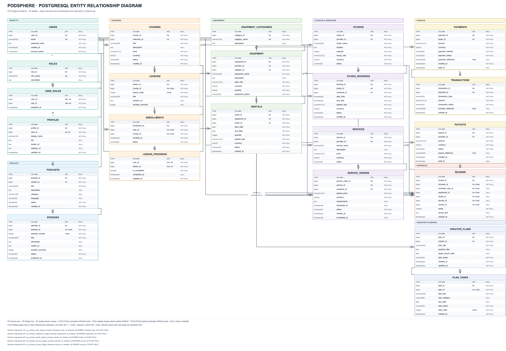

# CP2: PodSphere Entity-Relationship Diagram

## Scope and naming

This logical ER diagram carries forward all 23 relations from CP1. Relation names and attributes use lowercase `snake_case` in both this diagram and `03_schema.sql`; for example, CP1 `User_Roles` maps to `user_roles`, and `Lesson_Progress` maps to `lesson_progress`. The conversion changes identifier casing only, not the modeled attributes.

## Visual diagram

[ER diagram PNG](02_er_diagram.png)

```mermaid
erDiagram
    users ||--o{ user_roles : assigns
    roles ||--o{ user_roles : grants
    users ||--o| profiles : has

    users ||--o{ podcasts : creates
    podcasts ||--o{ episodes : contains

    users ||--o{ courses : instructs
    courses ||--o{ lessons : contains
    users ||--o{ enrollments : enrolls
    courses ||--o{ enrollments : has
    users ||--o{ lesson_progress : tracks
    lessons ||--o{ lesson_progress : records

    equipment_categories ||--o{ equipment : classifies
    users ||--o{ equipment : provides
    equipment ||--o{ rentals : rented_as
    users ||--o{ rentals : rents

    users ||--o{ studios : provides
    studios ||--o{ studio_bookings : booked_as
    users ||--o{ studio_bookings : books
    users ||--o{ services : provides
    services ||--o{ service_orders : ordered_as
    users ||--o{ service_orders : orders

    users ||--o{ payments : pays
    payments ||--o{ transactions : records
    users ||--o{ payouts : receives

    users ||--o{ reviews : reviewer_id
    users o|--o{ reviews : reviewed_user_id
    equipment o|--o{ reviews : optional_equipment_target
    studios o|--o{ reviews : optional_studio_target
    services o|--o{ reviews : optional_service_target
    courses o|--o{ reviews : optional_course_target

    users ||--o{ creator_plans : owns
    creator_plans ||--o{ plan_tasks : contains

    users {
        BIGINT user_id PK
        VARCHAR email UK
        TEXT password_hash
        TIMESTAMPTZ created_at
        VARCHAR account_status
    }
    roles {
        BIGINT role_id PK
        VARCHAR role_name UK
        TEXT description
    }
    user_roles {
        BIGINT user_id PK, FK
        BIGINT role_id PK, FK
        TIMESTAMPTZ assigned_at
    }
    profiles {
        BIGINT profile_id PK
        BIGINT user_id FK, UK
        VARCHAR display_name
        TEXT bio
        TEXT avatar_url
        TEXT website_url
        TIMESTAMPTZ updated_at
    }
    podcasts {
        BIGINT podcast_id PK
        BIGINT creator_id FK
        VARCHAR title
        TEXT description
        VARCHAR category
        VARCHAR language
        VARCHAR status
        TIMESTAMPTZ created_at
    }
    episodes {
        BIGINT episode_id PK
        BIGINT podcast_id FK
        INTEGER episode_number
        VARCHAR title
        TEXT description
        TEXT media_url
        INTEGER duration_seconds
        VARCHAR status
        TIMESTAMPTZ published_at
    }
    courses {
        BIGINT course_id PK
        BIGINT instructor_id FK
        VARCHAR title
        TEXT description
        NUMERIC price
        CHAR currency
        VARCHAR status
        TIMESTAMPTZ created_at
    }
    lessons {
        BIGINT lesson_id PK
        BIGINT course_id FK
        INTEGER lesson_order
        VARCHAR title
        TEXT content_url
        INTEGER duration_seconds
    }
    enrollments {
        BIGINT enrollment_id PK
        BIGINT user_id FK
        BIGINT course_id FK
        TIMESTAMPTZ enrolled_at
        VARCHAR status
    }
    lesson_progress {
        BIGINT user_id PK, FK
        BIGINT lesson_id PK, FK
        BOOLEAN is_completed
        TIMESTAMPTZ completed_at
        TIMESTAMPTZ updated_at
    }
    equipment_categories {
        BIGINT category_id PK
        VARCHAR category_name UK
        TEXT description
    }
    equipment {
        BIGINT equipment_id PK
        BIGINT provider_id FK
        BIGINT category_id FK
        VARCHAR equipment_name
        TEXT description
        NUMERIC daily_rate
        CHAR currency
        INTEGER quantity
        VARCHAR equipment_status
    }
    rentals {
        BIGINT rental_id PK
        BIGINT equipment_id FK
        BIGINT renter_id FK
        DATE start_date
        DATE end_date
        INTEGER quantity
        NUMERIC agreed_rate
        CHAR currency
        VARCHAR status
        TIMESTAMPTZ created_at
    }
    studios {
        BIGINT studio_id PK
        BIGINT provider_id FK
        VARCHAR studio_name
        TEXT location
        INTEGER capacity
        NUMERIC hourly_rate
        CHAR currency
        VARCHAR status
    }
    studio_bookings {
        BIGINT booking_id PK
        BIGINT studio_id FK
        BIGINT customer_id FK
        TIMESTAMPTZ start_time
        TIMESTAMPTZ end_time
        NUMERIC agreed_rate
        CHAR currency
        VARCHAR status
        TIMESTAMPTZ created_at
    }
    services {
        BIGINT service_id PK
        BIGINT provider_id FK
        VARCHAR service_name
        TEXT description
        NUMERIC price
        CHAR currency
        VARCHAR status
    }
    service_orders {
        BIGINT service_order_id PK
        BIGINT service_id FK
        BIGINT customer_id FK
        NUMERIC agreed_price
        CHAR currency
        TEXT requirements
        TIMESTAMPTZ scheduled_at
        VARCHAR status
        TIMESTAMPTZ created_at
        TIMESTAMPTZ completed_at
    }
    payments {
        BIGINT payment_id PK
        BIGINT payer_id FK
        NUMERIC amount
        CHAR currency
        VARCHAR payment_method
        VARCHAR payment_status
        VARCHAR payment_reference
        TIMESTAMPTZ created_at
        TIMESTAMPTZ paid_at
    }
    transactions {
        BIGINT transaction_id PK
        BIGINT payment_id FK
        VARCHAR transaction_type
        NUMERIC amount
        VARCHAR transaction_status
        VARCHAR provider_reference
        TIMESTAMPTZ created_at
    }
    payouts {
        BIGINT payout_id PK
        BIGINT provider_id FK
        NUMERIC amount
        CHAR currency
        VARCHAR status
        VARCHAR payout_reference
        TIMESTAMPTZ created_at
        TIMESTAMPTZ paid_at
    }
    reviews {
        BIGINT review_id PK
        BIGINT reviewer_id FK
        BIGINT reviewed_user_id FK
        BIGINT equipment_id FK
        BIGINT studio_id FK
        BIGINT service_id FK
        BIGINT course_id FK
        SMALLINT rating
        TEXT review_text
        TIMESTAMPTZ created_at
    }
    creator_plans {
        BIGINT plan_id PK
        BIGINT creator_id FK
        VARCHAR plan_title
        TEXT podcast_idea
        DATE target_launch_date
        VARCHAR plan_status
        TIMESTAMPTZ created_at
        TIMESTAMPTZ updated_at
    }
    plan_tasks {
        BIGINT task_id PK
        BIGINT plan_id FK
        VARCHAR task_title
        VARCHAR task_category
        DATE due_date
        VARCHAR task_status
        INTEGER task_order
        TIMESTAMPTZ created_at
    }
```

## Notation and constraints

- `PK`, `FK`, and `UK` denote primary, foreign, and unique keys. Composite keys are marked on each participating attribute; the SQL file names the full composite constraints.
- In the visual export, `CUQ1`/`CUQ2` identify the first and second columns of a composite `UNIQUE` constraint. Neither component is unique by itself. `PUQ` marks a single-column partial unique index; `PUQ1`/`PUQ2` identify the columns of a partial composite unique index.
- Single-column alternate keys are `users.email`, `roles.role_name`, `profiles.user_id`, and `equipment_categories.category_name`. Composite unique keys are `(podcast_id, episode_number)`, `(course_id, lesson_order)`, `(user_id, course_id)`, and `(plan_id, task_order)` in their respective relations; neither component is unique alone.
- `payment_reference`, `provider_reference`, and `payout_reference` are nullable and marked `PUQ`; their partial unique indexes apply only when the reference is non-null, so they are not candidate keys for the full relation.
- `||` means exactly one; `o|` means zero or one; `o{` means zero or many. Thus `users ||--o| profiles` means a user may have no profile or one profile, and each profile belongs to exactly one user.
- `user_roles`, `enrollments`, and `lesson_progress` resolve many-to-many relationships. Each junction row references exactly one row on each side.
- The two `users`-to-`reviews` relationships are distinct: required `reviews.reviewer_id` identifies the author, while nullable `reviews.reviewed_user_id` is one possible target. The visual exports label both links with these FK column names.
- Exactly one review target must be populated among `reviewed_user_id`, `equipment_id`, `studio_id`, `service_id`, and `course_id`; `ck_reviews_exactly_one_target` enforces this rule. Five separate partial unique indexes prevent a reviewer from submitting another review for the same target:

| Index | Unique columns | Predicate |
| --- | --- | --- |
| `uq_reviews_user_target_reviewer` | `(reviewed_user_id, reviewer_id)` | `reviewed_user_id IS NOT NULL` |
| `uq_reviews_equipment_target_reviewer` | `(equipment_id, reviewer_id)` | `equipment_id IS NOT NULL` |
| `uq_reviews_studio_target_reviewer` | `(studio_id, reviewer_id)` | `studio_id IS NOT NULL` |
| `uq_reviews_service_target_reviewer` | `(service_id, reviewer_id)` | `service_id IS NOT NULL` |
| `uq_reviews_course_target_reviewer` | `(course_id, reviewer_id)` | `course_id IS NOT NULL` |

    Each pair is marked `PUQ1`/`PUQ2` in the visual table, not as individual unique columns.
- Mermaid does not express check constraints, partial unique indexes, temporal overlap, aggregate rental inventory, or cross-table role/enrollment validation. The SQL uses a native GiST exclusion constraint over integer and timestamp ranges for confirmed studio bookings; it does not require `btree_gist`.
- Rentals use half-open date ranges `[start_date, end_date)`. Confirmed and active rentals reserve inventory; requested rentals do not. A trigger locks the equipment row and checks peak overlapping quantity at each interval start under PostgreSQL `READ COMMITTED` isolation (the default). This schema rejects reservation or quantity-reduction operations at stronger isolation levels.
- Lesson progress requires an enrollment in the lesson's course. SQL triggers guard progress writes, protect enrollment rows from deletion/reassignment while progress exists, and prevent moving a lesson to another course after progress exists. Provider/instructor role membership remains an application-level or dedicated-trigger rule.